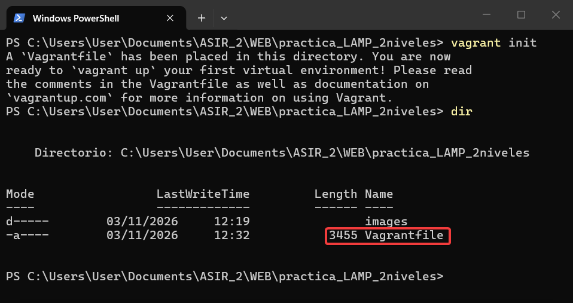
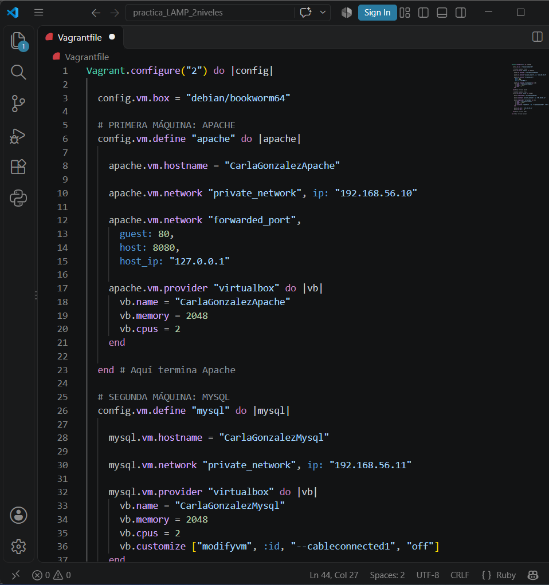
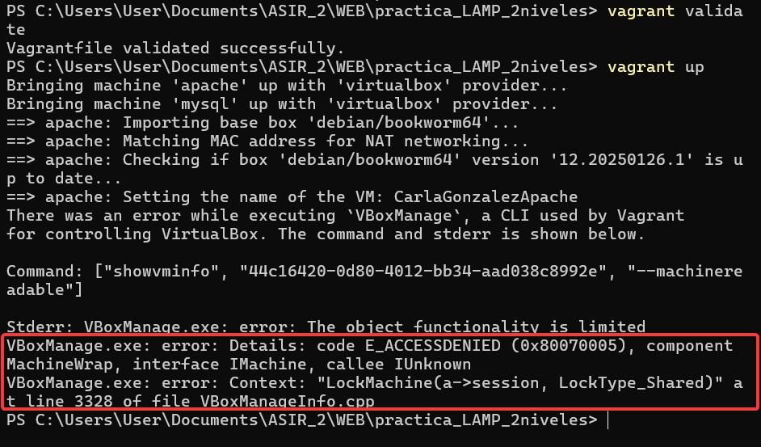
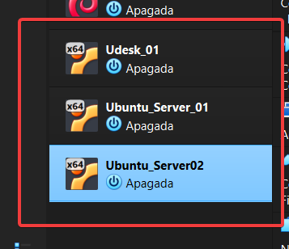
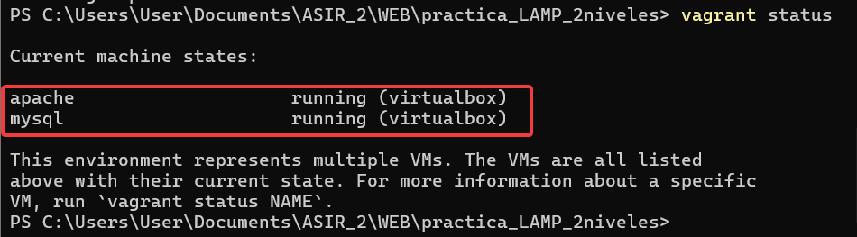
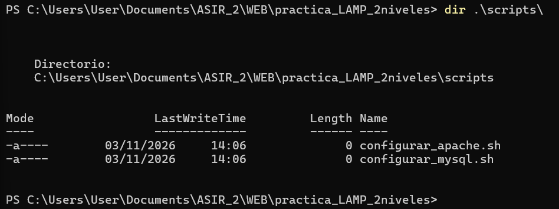

# Tarea: Pila LAMP en dos niveles
## Carla González Da Costa
## IWEB - ASIR 2º 
### 03/11/2026.


## 1. Introducción

El objetivo de esta práctica es desplegar una infraestructura web de dos niveles utilizando Vagrant y máquinas virtuales con Debian 12.

La infraestructura estará formada por dos máquinas virtuales independientes:

- **Servidor Apache:** encargado de alojar la aplicación web desarrollada en PHP.
- **Servidor MySQL:** encargado de almacenar y gestionar los datos de la aplicación.

La aplicación utilizada será `iaw-practica-lamp`, que permite realizar operaciones de gestión de usuarios, como añadir, consultar, modificar y eliminar registros de una base de datos.

Ambos servidores se comunicarán mediante una red privada. Únicamente el servidor Apache tendrá acceso a Internet a través de NAT, mientras que el servidor MySQL permanecerá sin acceso a Internet.


## 2. Estructura de la infraestructura

La infraestructura está formada por dos máquinas virtuales:

| Máquina virtual | Hostname | Función |
| --- | --- | --- |
| Apache | CarlaGonzalezApache | Servidor web y PHP |
| MySQL | CarlaGonzalezMysql | Servidor de base de datos |

La comunicación entre ambas máquinas se realizará mediante una red privada con las siguientes direcciones IP:

| Servidor | Dirección IP |
| --- | --- |
| Apache | 192.168.56.10 |
| MySQL | 192.168.56.11 |


## 3. Configuración de vm con Vagrant:
Para comenzar la configuración del entorno, accedí desde PowerShell a la carpeta del proyecto y ejecuté el siguiente comando:
`vagrant init`--> para crear automáticamente un vagrantfile y a partir de este modificarlo según los requisitos de la práctica.


Estas son las modificaciones que hice.
- `config.vm.box = "debian/bookworm64"` --> seleccionar como SO Debian 12
- Definir las vm:
  `apache.vm.hostname = "CarlaGonzalezApache"`
  `mysql.vm.hostname = "CarlaGonzalezMysql"`
- Hardware:
  `vb.memory = 2048` RAM
`  vb.cpus = 2` cpu
- Configuración de la red:
  `apache.vm.network "private_network", ip: "192.168.56.10"`
  `mysql.vm.network "private_network", ip: "192.168.56.11"`
  De esta forma, ambos servidores podrán comunicarse entre sí sin necesidad de utilizar Internet.

La máquina Apache tendrá además un adaptador NAT para disponer de acceso a Internet, mientras que la máquina MySQL deberá permanecer sin conexión a Internet, tal como exige la práctica.

- Para acceder a la aplicación web desde el equipo anfitrión, se configuré el reenvío del puerto 8080 de Windows al puerto 80 de Apache:
  `apache.vm.network "forwarded_port",
  guest: 80,
  host: 8080,
  host_ip: "127.0.0.1"`

- Configuración de VirtualBox
  `apache.vm.provider "virtualbox" do |vb|
  vb.name = "CarlaGonzalezApache"
  vb.memory = 2048
  vb.cpus = 2
end`

  Hice lo mismo para la vm de mysql.

Una vez creado el vagrantfile, inicio las máquinas. 
- `vagrant up`

**INCIDENCIA:**

Al iniciar las máquinas virtuales con Vagrant, apareció un error porque VirtualBox tenía registradas tres máquinas como inaccesibles.


Después de investigar el problema, comprobé que las carpetas de esas máquinas se habían movido de `ASIR_2\ISO\VM` a `ASIR_2\ASO\VM`, pero VirtualBox seguía buscando los archivos en la ubicación anterior.

Para solucionarlo, quité las máquinas de la lista de VirtualBox, sin eliminar sus archivos, y las añadí de nuevo seleccionando sus archivos `.vbox` desde la nueva ubicación.

Finalmente, las máquinas volvieron a aparecer correctamente en VirtualBox.



## 4. Iniciar las máquinas.
- `vagrant up apache`
- `vagrant up mysql`

**INCIDENCIA:**
Al iniciar la máquina MySQL, Vagrant no conseguía establecer la conexión SSH y mostraba el error:

```text
Timed out while waiting for the machine to boot
```

Para localizar el problema, comprobé primero si el puerto SSH de la máquina estaba accesible desde Windows:

```powershell
Test-NetConnection 127.0.0.1 -Port 2200
```

Después, consulté el estado de la máquina virtual y la configuración de sus adaptadores de red mediante:

```powershell
& "C:\Program Files\Oracle\VirtualBox\VBoxManage.exe" showvminfo "CarlaGonzalezMysql" --machinereadable | Select-String "VMState|cableconnected|nic1|Forwarding"
```

Al revisar el resultado, comprobé que el adaptador NAT estaba desconectado (`cableconnected1="off"`).

Para solucionarlo, volví a conectar el adaptador mediante el siguiente comando:

```powershell
& "C:\Program Files\Oracle\VirtualBox\VBoxManage.exe" controlvm "CarlaGonzalezMysql" setlinkstate1 on
```

Por último, reinicié la máquina virtual desde Vagrant:

```powershell
vagrant reload mysql
```

Tras realizar estos pasos, Vagrant consiguió establecer la conexión SSH y completar correctamente el arranque de la máquina virtual.
Todo estos comandos pude ejecutarlos buscando información sobre este error. 


## 5. Scripts de aprovisionamiento

Para automatizar la instalación y configuración de los servicios se utilizarán scripts Bash independientes para cada máquina virtual.

La estructura prevista es:

```text
scripts/
├── configurar_mysql.sh
└── configurar_apache.sh
```

- `configurar_mysql.sh`: instalará y configurará el servidor de bases de datos.
- `configurar_apache.sh`: instalará y configurará Apache, PHP y los componentes necesarios para ejecutar la aplicación web.


Los scripts se ejecutarán automáticamente mediante el aprovisionamiento de Vagrant.

